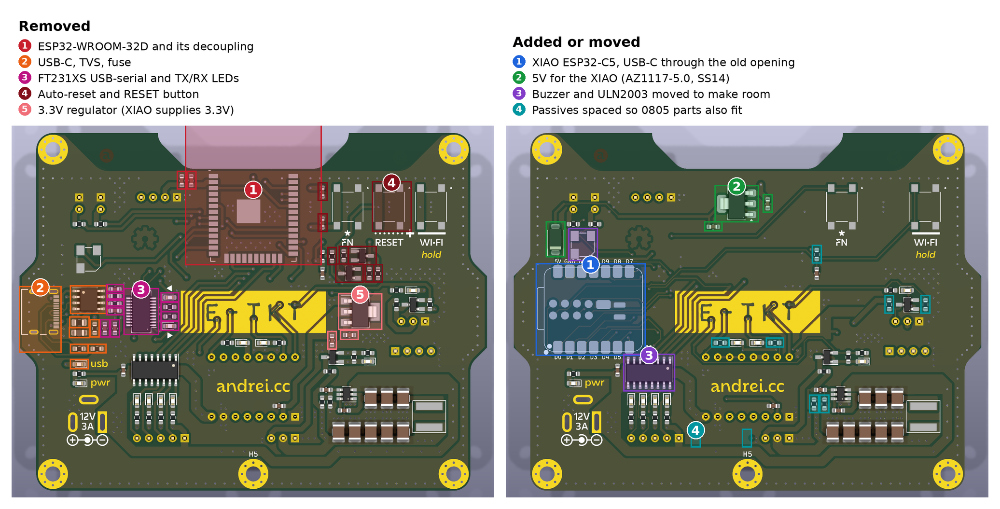
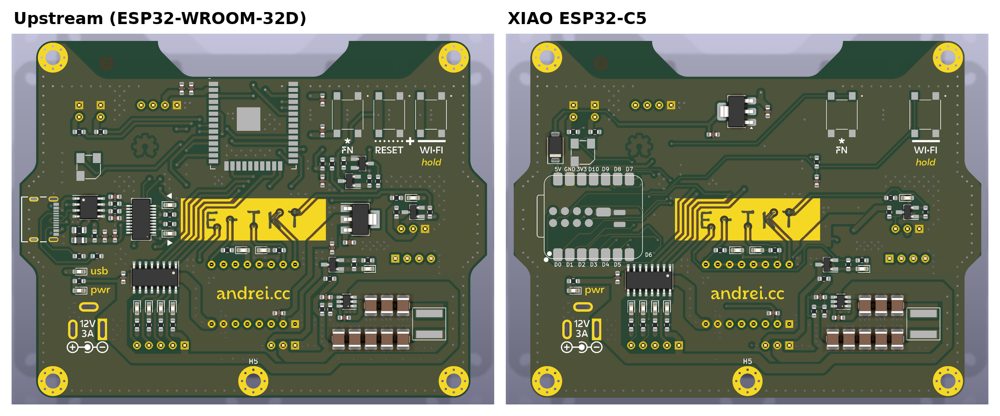
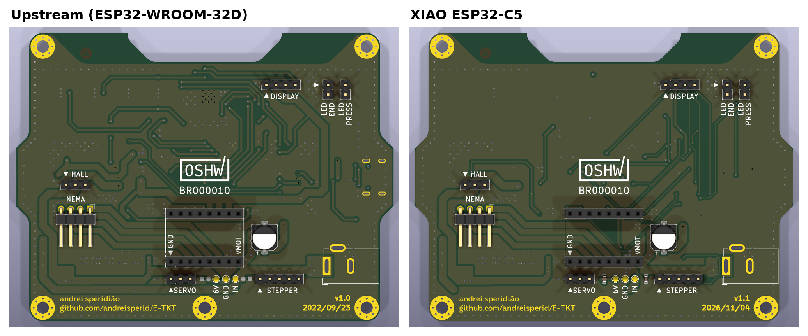

# XIAO ESP32-C5 carrier: board changes

Replaces the ESP32-WROOM-32D, FT231XS serial bridge and USB-C circuit with a
Seeed Studio XIAO ESP32-C5 soldered flat (SMD footprint) so its bottom pads are
reachable. Mechanics, motors and connectors stay as in upstream.

## Pin map

The XIAO has 11 edge GPIO plus 4 GPIO and BOOT on the bottom. E-TKT uses all
16: 14 signals plus the FN and WI-FI buttons.

Strapping pins, from the ESP32-C5 datasheet (v0.5, section 3): GPIO26-28 set
the boot mode, GPIO7 the JTAG source, GPIO25 and MTDI (GPIO3) the SDIO clock
edge, and MTMS (GPIO2) the crystal only in download mode. Only high-impedance
loads go on them: A4988 STEP/DIR and the end LED (a white LED through 27R does
not conduct at the internal pull level). Anything with a pull resistor, a coil
or a ULN2003 input stays on non-strapping pins. The two exceptions are
deliberate: the WI-FI button's pull-up and debounce cap on MTDI only change the
SDIO edge, which E-TKT does not use, and FN on BOOT is meant to change the boot
mode.

| Signal (old net) | Old GPIO | XIAO pad | C5 GPIO | Strap | Note |
|---|---|---|---|---|---|
| HALL | IO34 | D0 | 1 | no | ADC capable, needed by `analogRead` |
| OLED SDA | IO21 | D4 | 23 | no | |
| OLED SCL | IO22 | D5 | 24 | no | |
| SERVO | IO14 | D8 | 8 | no | BSS138 shifter has pull-ups |
| ULN 1 | IO15 | D1 | 0 | no | ULN2003 input pulls low |
| ULN 2 | IO4 | D9 | 9 | no | |
| ULN 3 | IO2 | D10 | 10 | no | |
| ULN 4 | IO16 | MTDO (bottom) | 5 | no | |
| NEMA ENA | IO25 | MTCK (bottom) | 4 | no | A4988 EN has an internal pull-down |
| BUZZER | IO26 | D7 | 12 | no | UART0 RX, input at boot |
| LED PRESS | IO17 | D6 | 11 | no | UART0 TX; ROM boot log flickers the LED |
| NEMA STEP | IO32 | D2 | 25 | yes | A4988 input, high impedance |
| NEMA DIR | IO33 | D3 | 7 | yes | A4988 input, high impedance |
| LED END | IO5 | MTMS (bottom) | 2 | yes | |
| WIFI RST | IO13 | MTDI (bottom) | 3 | yes | 10K pull-up and 0.1uF, as upstream |
| FN | IO0 | BOOT (bottom) | 28 | yes | Held while the XIAO resets: download mode |

`3V3_OUT` (pad 12) feeds the board's 3.3V rail. Unused: `EN`, `VBAT` and the
second `3V3_OUT` pad.

## Schematic changes

- `mcu.kicad_sch`: `U_MCU1` is now `Seeed_XIAO:XIAO-ESP32-C5-SMD`. Signal
  labels are named after the XIAO pad (`D8 SERVO`, `MTCK NEMA ENA`, ...).
  `SW_DFU1` (FN) sits on `BOOT`; `GND` and `PAD` go to `GNDREF`.
- Removed sheets `serial` (FT231XS), `usb` (USB-C, USB6B1 TVS, polyfuse,
  ferrite) and `boot` (auto-reset transistors, EN/IO0 buttons), and the root
  `VBUS` symbols. The XIAO has its own USB-C, USB serial and reset button; FN
  moved into the MCU sheet as above.
- Removed sheet `power3v3` (AZ1117-3.3 and its two caps). The 3.3V loads (OLED,
  A4988 logic, two pull-ups) draw about 30 mA, and the XIAO's `3V3_OUT` comes
  from an SGM6029 buck marked "Imax=1A" through a TPS22916 2A load switch
  (Seeed XIAO ESP32-C5 schematic v1.1, page 4). The ESP32-C5 itself peaks
  around 0.5A during WiFi transmit. A `PWR_FLAG` marks the rail as driven.
- New sheet `power5v`: AZ1117-5.0 (`U_POW3`) from the 6V rail makes
  `+5V_XIAO`. `D_VBUS1` (SS14) feeds it into the XIAO `VBUS` pad. The XIAO's
  USB-C reaches `VBUS` through a TPS22916 whose reverse-current blocking only
  trips around 500 mA, so without the diode the board could push current back
  into a PC. `C_POW5V2` is the 5V output cap; the WROOM decoupling caps
  `C_MCU1`/`C_MCU2` are removed.
- `wifireset` is upstream's sheet unchanged, now wired to `MTDI`.
- Unchanged: `power12v`, `power6v` (TPS54302), `levelshift`, `connectors`,
  `charstepper`, `feedstepper`.
- Project library tables `sym-lib-table` and `fp-lib-table` add the
  `Seeed_XIAO` library from `kicad-lib/`.

## Layout

- The XIAO sits on the left edge where the upstream USB-C connector was, with
  its USB-C facing out through the same opening in `G_pillar`. The module
  starts 6.5 mm in from the edge, just past where `G_pillar` covers the
  component side (6.0 mm). The receptacle is 0.5 mm off the opening's center,
  so cables with an overmold up to 11.5 mm wide fit; upstream allowed 12.6 mm.
  Checked against the STEP models in `_3dprint/source`.
- The XIAO pad names are printed next to its pads. `D6` sits past the
  module's end, clear of the ULN2003.
- FN and WI-FI keep their upstream spots and artwork. The RESET button is
  dropped: the XIAO has its own.
- `U_POW3` and `C_POW5V1/2` sit in the top-edge notch area that cleared the
  WROOM antenna; the C5 uses an external U.FL antenna. `D_VBUS1` sits above the
  XIAO `VBUS` pad. A `5v` net class (0.5 mm) covers `+5V_XIAO` and the
  diode-to-VBUS net.
- To make room and leave space for a soldering iron along the XIAO's
  castellated pads, the buzzer `LS1` moved up 3.1 mm and the ULN2003 `U_STP1`
  moved down 0.6 mm, with its tracks and the `+12V` bus under it. Only
  `U_STP1` sits within 1 mm of a XIAO pad (0.61 mm).
- Routed with Freerouting, then checked in KiCad: no unconnected items,
  schematic parity clean, no new DRC error types. `+3.3V` necks down to 0.3 mm
  in a few places to get out of pad 12; it carries about 30 mA.
- Resistor and capacitor spacing and routing also fit the 0805 hand-solder
  footprints: swapping every 0603 R and C to 0805 passes DRC with no new
  errors. The 0603 LEDs keep upstream's spacing.
- The front "E-TKT" logo keeps upstream's tracks: the same stripes and the
  same vias in the letters, now carrying the XIAO signals for the steppers,
  servo and hall sensor. The ULN stripes end in vias just above the logo
  opening, hidden under the mask. Three pieces stay as artwork only and show
  up as dangling in DRC: the vias in the "-" and the first "T" (ENA, STEP)
  and the top of the ULN4 stripe. A rule area keeps tracks out of the
  "andrei.cc" opening.
- Removed the "usb" label and the TX/RX triangles, whose LEDs are gone. New
  parts keep their reference hidden, like the rest of the board.
- The back reads `v1.1` and `2026/11/04`.
- The Seeed library is KiCad 10 format (`version 20251024`), so this branch
  needs KiCad 10.

## Firmware follow-ups

- `src/Configuration.h`: new GPIO numbers from the table above;
  `WIFI_RESET_PIN` becomes 3 (MTDI, the WI-FI button).
- `platformio.ini`: arduino-esp32 3.3.5 or later (Seeed's minimum), via the
  pioarduino platform. Set `-DARDUINO_USB_CDC_ON_BOOT=1` so `Serial` uses USB
  and UART0 pins stay free.
- Library updates for arduino-esp32 3.x: ESP32Servo, ESPAsyncWebServer
  (ESP32Async), ElegantOTA in place of AsyncElegantOTA.

## Unverified

- XIAO `VBUS` input range: not stated by Seeed. The board feeds about 4.6V
  after the diode, above the 4.33V where the XIAO's power mux would switch to
  `VBAT`.
- The ESP32-C5 datasheet used for the strapping pins is v0.5, marked
  preliminary.
- Bottom pad numbering: from the Seeed symbol (`15 MTDI`, `16 MTDO`,
  `19 MTMS`, `20 MTCK`, `21 BOOT`, `22 3V3_OUT`), not checked against a
  physical board.
- The FN and WI-FI footprints (`b3fs:B3FS-1000`) come from the upstream board;
  the `b3fs` library itself is not in the repository, as in upstream.
